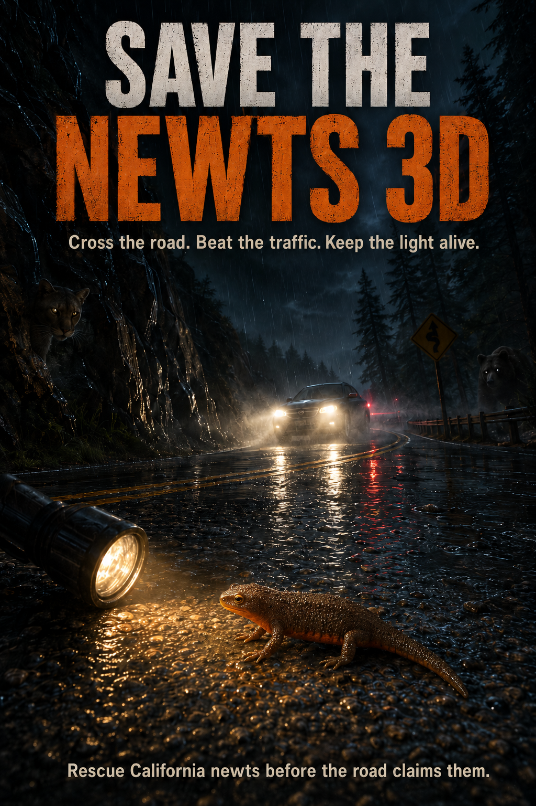

# Save the Newts 3D

Rescue California newts crossing a road at night.

**Controls:** WASD to move · Mouse to look · Walk into newts to rescue them

**Run:** `npm ci && npm run vendor && npm start` → http://localhost:3000

Android APKs are on the [Releases](https://github.com/karangattu/save-the-newts-3d/releases) page.

## Credits

Animal models (`assets/models/`) are low-poly models by Poly by Google via
[Poly Pizza](https://poly.pizza/), licensed under
[CC-BY 3.0](https://creativecommons.org/licenses/by/3.0/):

- [Black bear](https://poly.pizza/m/56ym_pyVnel)
- [Cougar](https://poly.pizza/m/8nuCN-gn2s-)
