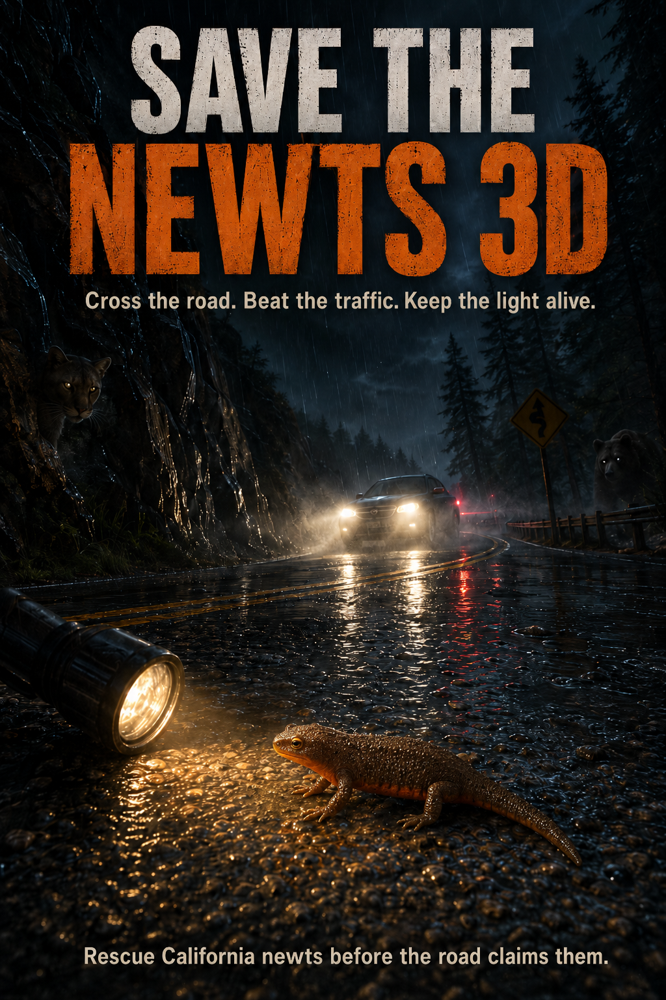

# Save the Newts 3D

Rescue California newts crossing a road at night.

**Controls:** WASD to move, Mouse to look, Walk into newts to rescue them.

**Run:** `npm ci && npm run vendor && npm start` (serves on `http://localhost:3000`)

All runtime libraries, icons, and fonts are vendored locally, so the game does
not need a CDN. The online leaderboard still uses Supabase when a network is
available.

## Android APK

The Android app is a Capacitor wrapper around the same web build.

Requirements:

- Node.js 22 or newer
- JDK 21
- Android SDK 36 (platform + build tools)

Make sure `JAVA_HOME` points at JDK 21 and `ANDROID_HOME`/`ANDROID_SDK_ROOT`
point at your Android SDK before building.

Build locally:

```bash
npm ci
npm run vendor
npm run android:build
```

The APK is written to `android/app/build/outputs/apk/debug/app-debug.apk`.

`npx cap build android` builds a release APK instead and requires the Capacitor
keystore options (`--keystorepath`, `--keystorepass`, `--keystorealias`,
`--keystorealiaspass`). The debug build above needs no signing setup.

Open the native project in Android Studio with:

```bash
npm run android:open
```

### Tagged releases

Push a tag from a commit on `main` (the `v` prefix is stripped from the APK
version name):

```bash
git tag v1.2.3
git push origin v1.2.3
```

`.github/workflows/android-apk.yml` verifies the tag is on `main`, builds the
APK, uploads it as a workflow artifact, and attaches
`save-the-newts-<version>.apk` plus a SHA-256 checksum to the GitHub Release.
The release build is debug-signed and intended for sideloading/testing.

## Graphics quality

Desktop and Android builds start on the full-detail preset. Android APK builds also
generate 2x procedural ground textures because all assets are packaged locally.
Adaptive quality still steps rendering resolution and detail down if a device
cannot hold frame rate.

Force a preset with `?quality=high` or `?quality=low` (useful for testing a
specific device or for a slower Android phone).


